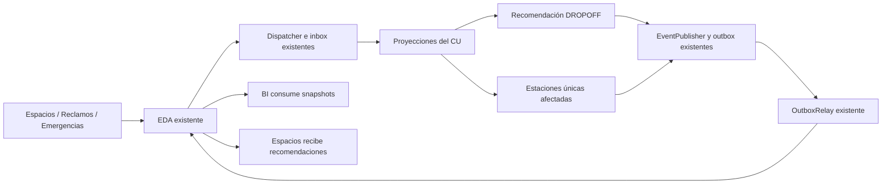

# Entrega CU-INT-01 y BI: estaciones afectadas por incidentes

## Alcance confirmado

Para el Caso 4, Movilidad entrega a BI solamente **cantidad de estaciones afectadas por incidentes**.
No se incorporan las métricas anteriores de viajes ni cantidades de incidentes. La fecha del snapshot
permite a BI ubicar el valor en el tiempo; no constituye un indicador adicional.

Se reutiliza la integración EDA ya existente: `EventDispatcher` + inbox para consumir,
`EventPublisher` + outbox + `OutboxRelay` para publicar y `EventTypeRegistrar` para contratos.
No se añade otro cliente HTTP, consumidor Kafka, autenticación, gateway ni mecanismo de reintentos.
Login y la infraestructura general EDA siguen a cargo de los compañeros responsables.



## Métrica BI implementada

Contrato propio en `src/main/resources/eventbus/event-types/EstacionesAfectadasActualizadas.json`.
Tópico/FQN esperado: `com.citypass.movilidad.EstacionesAfectadasActualizadas`.
El payload de negocio tiene exactamente dos campos:

```json
{
  "cantidadEstacionesAfectadas": 5,
  "calculadaEn": "2026-10-30T12:00:00Z"
}
```

`cantidadEstacionesAfectadas` es `int`; `calculadaEn` es `string` ISO-8601 UTC.
La metadata del bus la agrega la infraestructura existente, no se duplica dentro del payload.
Este schema de transporte debe confirmarse con BI/EDA antes del registro compartido. No se registró
ni actualizó ningún tipo en el gateway real durante esta entrega. Si ya existe otro schema registrado,
coordinar su compatibilidad: el registrar existente no lo sobrescribe automáticamente.

Reglas:

- Se consulta todo el catálogo, sin depender de un evento cultural ni del límite de candidatas.
- Solo estaciones ACTIVE y no eliminadas.
- Solo incidentes activos proyectados por el CU que afectan circulación y tienen coordenadas válidas.
- Una estación se cuenta una sola vez aunque haya varios incidentes próximos.
- Distancia Haversine <= `movilidad.incidents.radius-meters`, 300 m por defecto, el mismo parámetro del filtro del CU.
- Se publica después del commit de incidentes creados/resueltos y cada 15 minutos.
- Al resolver el último incidente se publica cero. Sin incidentes, el snapshot periódico también es cero.
- El recálculo periódico captura cambios de alta/baja/estado del catálogo de estaciones.
- La métrica es un **snapshot**, no un incremento: BI debe tomar el último valor por fecha, no sumar snapshots.
- Fallos previos a persistir el snapshot se recuperan en el próximo refresco; una vez en outbox,
  el relay existente administra reintentos. No se condiciona el procesamiento de un incidente a que BI esté disponible.

El cron se puede configurar con `movilidad.analytics.affected-stations.cron`;
por defecto `0 */15 * * * *`. En tests que verifican otras cosas se usa `-` para aislar
el timer; el evento AFTER_COMMIT y el refresco invocado explícitamente sí se prueban.
El backend debe permanecer activo para ejecutar los cron.

## Demanda del destino en CU-INT-01

La migración nueva es `V11__cultural_destination_demand.sql`. No se modifican V1–V10.
Se conserva `full_capacity` para el estado documentado `ACTIVE_FULL`:

- Evento normal: demanda de referencia = inscriptos conocidos.
- ACTIVE_FULL: demanda de referencia = cupo máximo.
- Actualizaciones explícitas de inscriptos pueden disminuir el valor (antes solo se guardaba el máximo histórico).
- Si falta inscriptos o estado, se conserva el dato conocido; no se inventa ReservaConfirmada.

Regla implementada, revisable con Espacios: tras excluir incidentes y estaciones sin anclajes libres,
se priorizan las estaciones con anclajes suficientes para la demanda de referencia. Si ninguna alcanza,
se consideran las de mayor disponibilidad. La IA existente o su fallback decide dentro de ese grupo;
no se modifica ni se reentrena el modelo. Sin demanda conocida se conserva el criterio existente.
No se estima un porcentaje de asistentes en bicicleta: el número es una referencia conservadora,
no una predicción de viajes ni una garantía/reserva de anclajes.

Esta regla se aplica solo a destinos del CU. La recomendación general PICKUP/DROPOFF sigue usando su
comportamiento anterior. La recomendación publicada usa el mismo snapshot ya filtrado para contar
los descartes y decidir la estación, evitando una segunda consulta que podía observar otros incidentes
u otra disponibilidad. El contrato de 12 campos de RecomendacionDestinoActualizada se conserva.
La API de eventos agrega `expectedDemand`; la UI lo muestra y distingue el cupo completo.

## Dónde está cada cambio

| Archivo/clase | Responsabilidad |
| --- | --- |
| AffectedStationsMetricsService | Conteo global, estaciones únicas, radio y filtros |
| AffectedStationsMetricsPublisher | Snapshot al commit y refresco de 15 minutos |
| AffectedStationsEventWriter | Transacción REQUIRES_NEW que delega al EventPublisher existente |
| StationRepository | Consulta de estaciones activas no eliminadas |
| EstacionesAfectadasActualizadas.json | Schema mínimo para la única métrica acordada |
| CulturalDestination / V11 | Persistencia de cupo completo y cálculo de demanda de referencia |
| InboundEventService | Proyección de ACTIVE_FULL y actualización del número de inscriptos |
| StationRecommendationService | Selección de candidatas según demanda, manteniendo IA y fallback |
| CulturalDestinationService | Recomendación del endpoint según demanda del evento |
| DestinationRecommendationPublisher | Reutiliza el snapshot seguro para publicación del CU |
| CulturalDestinationResponse | Campo REST adicional expectedDemand |

Los archivos Java están bajo `src/main/java/com/citypass/movilidad/` en sus paquetes habituales.
Se incorporaron selectivamente los archivos de la rama BI de estaciones afectadas; no se fusionó una
versión vieja del CU ni se mezcló `feat/integracion-bi` de viajes. Las ramas originales se conservan.

## Validación y reproducción

Tests nuevos/revisados:

- AffectedStationsMetricsServiceTest: superposición sin doble conteo, cero, fuera de radio y radio configurable.
- AffectedStationsMetricsPublisherTest: exactamente los dos campos acordados y recuperación tras fallo.
- AffectedStationsEventWriterTest: usa el publicador/outbox oficial.
- AffectedStationsBiIntegrationTest: MySQL y Flyway reales, estaciones activas/inactivas/eliminadas,
  creación y resolución de incidentes, snapshots 1→1→1→0, rollback sin publicación y refresco periódico.
  También verifica el contrato JSON versionado.
- CulturalDestinationDemandTest: cobertura de demanda, disponibilidad insuficiente, demanda desconocida,
  ausencia de anclajes, IA caída y exclusión de incidentes antes de elegir candidatas.
- InboundEventServiceTest: ACTIVE_FULL y descenso posterior de inscriptos.
- CuInt01PersistenceIntegrationTest: endpoints reales de eventos/recomendación y cancelación, además
  de sus pruebas previas de commit/rollback/outbox e invalidaciones.
- MigrationUpgradeIntegrationTest: migración de la V6 oficial hasta V11 y repetibilidad.

Validación oficial desde backend:

```sh
bash gradlew --no-daemon clean compileJava test jacocoTestReport
OPENBLAS_NUM_THREADS=1 OMP_NUM_THREADS=1 recommendation-service/.venv/bin/python -m pytest recommendation-service --cov=recommendation-service/app --cov=recommendation-service/training --cov-config=recommendation-service/.coveragerc --cov-report=xml:recommendation-service/coverage.xml
```

El entorno local tiene Confluent bloqueado; el arnés externo de diagnóstico
`/workspace/.setup/cu-unit-tests.init.gradle` excluye únicamente su integración específica y no
reemplaza el build oficial. El pipeline del PR ejecuta la suite con las dependencias oficiales.
Las pruebas locales del CU usan payloads controlados y MySQL real. No son una prueba con productores
reales de otros módulos ni con el consumidor real de BI. Los resultados definitivos se informan por commit.

## Qué falta confirmar y con quién

| Responsable | Confirmación o entrega pendiente |
| --- | --- |
| BI | Aceptar nombre/tópico, campos y tipos del snapshot; consumirlo como valor absoluto por fecha; URL HTTPS del HTML; permisos CSP/frame y autenticación del embed |
| Espacios | Schema exacto de ReservaConfirmada; publicación real y consumidor de RecomendacionDestinoActualizada; semántica de inscriptos/ACTIVE_FULL y validación de la regla de demanda; versiones/fechas para ordenar actualizaciones |
| Reclamos | Schemas definitivos de creación/actualización/resolución, publicación real, estados terminales, cambios de coordenadas/afectaCirculacion y garantías de orden |
| Emergencias | Lo mismo para EmergenciaCreada/EmergenciaActualizada; acordar reaperturas y cambios de ubicación sin inventar campos |
| Compañero de EDA / Grupo 1 | Revisar contratos propios nuevos y registros existentes; verificar permisos/suscripciones en el entorno de integración y coordinar prueba real/reprocesamiento |

La guía general del caso contiene nombres antiguos de eventos. Se mantienen los nombres posteriores
acordados en el CU; cualquier alias o cambio exige el schema del productor. No se implementa un
handler de ReservaConfirmada ni reaperturas por suposición. La redistribución física de bicicletas,
que el PDF menciona como posibilidad, no se automatiza ni se generan órdenes sin reglas operativas.
No hay cambios de Login, permisos generales, credenciales ni infraestructura EDA.

## Prueba conjunta pendiente

Publicar evento cultural → ver demanda y recomendación → crear incidente cercano → verificar
alternativa/invalidez y snapshot BI → resolver incidente → verificar recuperación y snapshot cero →
cancelar evento → verificar última invalidación → comprobar que BI muestra el indicador en su HTML.
Debe ejecutarse en un ambiente de integración, con backend activo, sin desplegar esta rama a producción.
