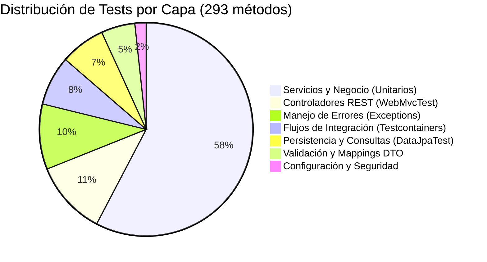

# Relevamiento e Inventario de la Suite de Tests
**Proyecto:** `DAII-Grupo-8-Backend` (CityPass Movilidad)  
**Fecha de corte:** Septiembre 2026  
**Entorno de ejecución:** Java 17 / Spring Boot 3 / JUnit Jupiter 5

---

## 1. Resumen Ejecutivo y Métricas Clave

El proyecto cuenta con una suite de pruebas automatizadas sólida y diversificada a lo largo de todas las capas de la arquitectura hexagonal/multicapa (Dominio, Servicios, Controladores Web, Repositorios JPA e Integración con contenedores reales).



### Tabla de Métricas Principales

| Métrica | Valor | Observaciones |
| :--- | :---: | :--- |
| **Archivos de Test (`*.java`)** | **38** | Ubicados en [`src/test/java`](file:///c:/Users/jerom/Documents/DAII-Grupo-8-Backend/src/test/java) |
| **Métodos de Test Declarados** | **293** | 290 con `@Test` y 3 con `@ParameterizedTest` |
| **Ejecuciones Totales de Prueba** | **302** | Incluye 12 casos evaluados en tests parametrizados |
| **Tests Deshabilitados (`@Disabled`)** | **0** | El 100% de la suite está activa y funcional |
| **Tests con Contenedores Reales** | **22** | Utilizan Testcontainers con base PostgreSQL |

---

## 2. Pila Tecnológica de Pruebas

> [!NOTE]
> La estrategia de pruebas combina aislamiento rápido para pruebas unitarias con pruebas de integración de base de datos completa utilizando contenedores efímeros.

* **Motor de Ejecución:** JUnit Jupiter 5.x (`org.junit.jupiter.api`)
* **Aislamiento y Mocks:** Mockito 5.x (`org.mockito:mockito-core` / `mockito-junit-jupiter`)
* **Aserciones Fluent:** AssertJ (`org.assertj:assertj-core`)
* **Pruebas de Capa Web:** Spring Boot `MockMvc` con `@WebMvcTest`
* **Pruebas de Persistencia:** `@DataJpaTest` con Testcontainers PostgreSQL
* **Pruebas de Integración End-to-End:** `@SpringBootTest` + `@Testcontainers` (`org.testcontainers:postgresql`)
* **Validación de Bean Validation (JSR-380):** Hibernate Validator unitario

---

## 3. Desglose Detallado por Capa y Módulo

### 3.1. Servicios y Lógica de Negocio (169 tests)
Capa enfocada en las reglas de dominio, estados de bicicletas, trayectos, mantenimiento y algoritmo de recomendación de estaciones. Se prueban de forma unitaria con mocks de dependencias.

| Archivo de Test | Tests | Enfoque Principal |
| :--- | :---: | :--- |
| [`BikeServiceTest.java`](file:///c:/Users/jerom/Documents/DAII-Grupo-8-Backend/src/test/java/com/citypass/movilidad/service/BikeServiceTest.java) | **36** | Ciclo de vida y transiciones de estado de bicicletas (bloqueo, mantenimiento, disponibilidad, bajas). |
| [`TripServiceTest.java`](file:///c:/Users/jerom/Documents/DAII-Grupo-8-Backend/src/test/java/com/citypass/movilidad/service/TripServiceTest.java) | **25** | Inicio, finalización, cálculo de duraciones, validación de anclajes y reglas de trayectos. |
| [`StationRecommendationServiceTest.java`](file:///c:/Users/jerom/Documents/DAII-Grupo-8-Backend/src/test/java/com/citypass/movilidad/service/StationRecommendationServiceTest.java) | **14** | Lógica de recomendación de estaciones según coordenadas, disponibilidad y fallback a cliente externo. |
| [`MaintenanceServiceTest.java`](file:///c:/Users/jerom/Documents/DAII-Grupo-8-Backend/src/test/java/com/citypass/movilidad/service/MaintenanceServiceTest.java) | **11** | Registro de órdenes de mantenimiento, cambio de estados, validación de administradores y resolución. |
| [`RecommendationMessageComposerTest.java`](file:///c:/Users/jerom/Documents/DAII-Grupo-8-Backend/src/test/java/com/citypass/movilidad/service/RecommendationMessageComposerTest.java) | **10** | Armado de mensajes descriptivos para el usuario ante recomendaciones o alternativas de estación. |
| [`RecommendationClientTest.java`](file:///c:/Users/jerom/Documents/DAII-Grupo-8-Backend/src/test/java/com/citypass/movilidad/client/RecommendationClientTest.java) | **9** | Cliente HTTP hacia el microservicio o proveedor externo de recomendaciones con MockWebServer/RestClient. |
| [`StationAvailabilityServiceTest.java`](file:///c:/Users/jerom/Documents/DAII-Grupo-8-Backend/src/test/java/com/citypass/movilidad/service/StationAvailabilityServiceTest.java) | **9** | Cálculo y reporte de anclajes libres, bicis activas y capacidad por estación. |
| [`GeoBoundingBoxTest.java`](file:///c:/Users/jerom/Documents/DAII-Grupo-8-Backend/src/test/java/com/citypass/movilidad/service/GeoBoundingBoxTest.java) | **8** | Algoritmos matemáticos y delimitación de cuadrantes geográficos (Bounding Box) por lat/lng. |
| [`IncidentAdminServiceTest.java`](file:///c:/Users/jerom/Documents/DAII-Grupo-8-Backend/src/test/java/com/citypass/movilidad/service/IncidentAdminServiceTest.java) | **8** | Gestión administrativa y resolución de incidencias reportadas en bicicletas/estaciones. |
| [`StationServiceTest.java`](file:///c:/Users/jerom/Documents/DAII-Grupo-8-Backend/src/test/java/com/citypass/movilidad/service/StationServiceTest.java) | **8** | CRUD de estaciones, actualización de capacidades y validaciones de estación manual/dataset. |
| [`BikeStatusTransitionPolicyTest.java`](file:///c:/Users/jerom/Documents/DAII-Grupo-8-Backend/src/test/java/com/citypass/movilidad/service/BikeStatusTransitionPolicyTest.java) | **7** | Máquina de estados de bicicletas y verificación estricta de transiciones válidas e inválidas. |
| [`NearbyStationServiceTest.java`](file:///c:/Users/jerom/Documents/DAII-Grupo-8-Backend/src/test/java/com/citypass/movilidad/service/NearbyStationServiceTest.java) | **7** | Búsqueda geoespacial por radio y ordenamiento por distancia euclidiana/haversine. |
| [`EcobiciStationImportServiceTest.java`](file:///c:/Users/jerom/Documents/DAII-Grupo-8-Backend/src/test/java/com/citypass/movilidad/service/EcobiciStationImportServiceTest.java) | **6** | Lógica de importación e ingesta del dataset público de estaciones de Ecobici. |
| [`IncidentServiceTest.java`](file:///c:/Users/jerom/Documents/DAII-Grupo-8-Backend/src/test/java/com/citypass/movilidad/service/IncidentServiceTest.java) | **6** | Creación y reporte de incidentes por parte de usuarios finales. |

---

### 3.2. Controladores REST (`@WebMvcTest`) (33 tests)
Pruebas de la capa HTTP utilizando `MockMvc` con servicios mockeados, verificando códigos de estado HTTP, serialización JSON y manejo de validaciones de entrada (`@Valid`).

| Archivo de Test | Tests | Endpoint / Funcionalidad Evaluada |
| :--- | :---: | :--- |
| [`StationControllerTest.java`](file:///c:/Users/jerom/Documents/DAII-Grupo-8-Backend/src/test/java/com/citypass/movilidad/controller/StationControllerTest.java) | **9** | `/api/v1/stations`: Búsqueda, creación, actualización y filtrado de estaciones. |
| [`StationRecommendationControllerTest.java`](file:///c:/Users/jerom/Documents/DAII-Grupo-8-Backend/src/test/java/com/citypass/movilidad/controller/StationRecommendationControllerTest.java) | **8** | `/api/v1/stations/recommendations`: Consulta de recomendaciones de origen y destino. |
| [`NearbyStationControllerTest.java`](file:///c:/Users/jerom/Documents/DAII-Grupo-8-Backend/src/test/java/com/citypass/movilidad/controller/NearbyStationControllerTest.java) | **7** | `/api/v1/stations/nearby`: Filtros por coordenadas, radio y ordenamiento geográfico. |
| [`StationAvailabilityControllerTest.java`](file:///c:/Users/jerom/Documents/DAII-Grupo-8-Backend/src/test/java/com/citypass/movilidad/controller/StationAvailabilityControllerTest.java) | **3** | `/api/v1/stations/{id}/availability`: Consulta de disponibilidad en tiempo real. |
| [`BikeControllerTest.java`](file:///c:/Users/jerom/Documents/DAII-Grupo-8-Backend/src/test/java/com/citypass/movilidad/controller/BikeControllerTest.java) | **2** | `/api/v1/bikes`: Endpoints de gestión y consulta de bicicletas. |
| [`IncidentControllerTest.java`](file:///c:/Users/jerom/Documents/DAII-Grupo-8-Backend/src/test/java/com/citypass/movilidad/controller/IncidentControllerTest.java) | **2** | `/api/v1/incidents`: Reporte de incidencias por los usuarios. |
| [`TripControllerTest.java`](file:///c:/Users/jerom/Documents/DAII-Grupo-8-Backend/src/test/java/com/citypass/movilidad/controller/TripControllerTest.java) | **2** | `/api/v1/trips`: Inicio y finalización de viajes. |

---

### 3.3. Manejo de Excepciones y Errores (29 tests)
Verificación de los códigos de respuesta (`400 Bad Request`, `404 Not Found`, `409 Conflict`, `422 Unprocessable Entity`, `500 Internal Server Error`) y el formato estandarizado `ProblemDetail` / error payload.

| Archivo de Test | Tests | Enfoque Principal |
| :--- | :---: | :--- |
| [`GlobalExceptionHandlerTest.java`](file:///c:/Users/jerom/Documents/DAII-Grupo-8-Backend/src/test/java/com/citypass/movilidad/exception/GlobalExceptionHandlerTest.java) | **16** | Prueba de integración HTTP con controlador de prueba para mapeo de excepciones Spring MVC. |
| [`GlobalExceptionHandlerUnitTest.java`](file:///c:/Users/jerom/Documents/DAII-Grupo-8-Backend/src/test/java/com/citypass/movilidad/exception/GlobalExceptionHandlerUnitTest.java) | **13** | Pruebas unitarias directas sobre los métodos del `@RestControllerAdvice`. |

---

### 3.4. Integración End-to-End con Base de Datos Real (22 tests)
Pruebas con `@SpringBootTest` y `@Testcontainers` levantando una base de datos PostgreSQL real en Docker para comprobar transacciones, constraints y flujos completos entre múltiples entidades.

| Archivo de Test | Tests | Flujo Evaluado |
| :--- | :---: | :--- |
| [`TripFlowIntegrationTest.java`](file:///c:/Users/jerom/Documents/DAII-Grupo-8-Backend/src/test/java/com/citypass/movilidad/TripFlowIntegrationTest.java) | **10** | Flujo completo de viaje: retiro de bici, bloqueo, cambio de anclaje, devolución y persistencia en DB. |
| [`StationRecommendationIntegrationTest.java`](file:///c:/Users/jerom/Documents/DAII-Grupo-8-Backend/src/test/java/com/citypass/movilidad/StationRecommendationIntegrationTest.java) | **5** | Flujo completo de recomendación con datos de estaciones y disponibilidad persistidos en Postgres. |
| [`IncidentFlowIntegrationTest.java`](file:///c:/Users/jerom/Documents/DAII-Grupo-8-Backend/src/test/java/com/citypass/movilidad/IncidentFlowIntegrationTest.java) | **4** | Flujo completo de reporte de incidente, cambio de estado de bicicleta a mantenimiento y resolución. |
| [`MovilidadBackendApplicationTests.java`](file:///c:/Users/jerom/Documents/DAII-Grupo-8-Backend/src/test/java/com/citypass/movilidad/MovilidadBackendApplicationTests.java) | **3** | Verificación de carga de contexto de Spring Boot (`contextLoads`) y configuración general. |

---

### 3.5. Capa de Persistencia y Consultas Espaciales (20 tests)
Pruebas con `@DataJpaTest` sobre repositorios Spring Data JPA con queries complejas (cálculo de distancias, historial y agregaciones).

| Archivo de Test | Tests | Enfoque de Consulta |
| :--- | :---: | :--- |
| [`NearbyStationQueryTest.java`](file:///c:/Users/jerom/Documents/DAII-Grupo-8-Backend/src/test/java/com/citypass/movilidad/repository/NearbyStationQueryTest.java) | **7** | Consulta geoespacial de estaciones cercanas dentro de un rango de tolerancia y ordenamiento. |
| [`TripHistoryQueryTest.java`](file:///c:/Users/jerom/Documents/DAII-Grupo-8-Backend/src/test/java/com/citypass/movilidad/repository/TripHistoryQueryTest.java) | **6** | Queries de historial de viajes por usuario, fechas y paginación. |
| [`RepositoryPersistenceTests.java`](file:///c:/Users/jerom/Documents/DAII-Grupo-8-Backend/src/test/java/com/citypass/movilidad/repository/RepositoryPersistenceTests.java) | **5** | Integridad referencial, claves foráneas y auditoría de entidades principales. |
| [`StationAvailabilityQueryTest.java`](file:///c:/Users/jerom/Documents/DAII-Grupo-8-Backend/src/test/java/com/citypass/movilidad/repository/StationAvailabilityQueryTest.java) | **2** | Agregaciones SQL para conteo de bicis activas y disponibilidad por estación. |

---

### 3.6. Validaciones de Dominio y Mappers DTO (15 tests / 24 ejecuciones)
Verificación de mappers estructurales y validaciones con JSR-380 (`@Valid`, anotaciones custom de latitud, longitud e IDs de entidad).

| Archivo de Test | Tests | Ejecuciones | Detalle |
| :--- | :---: | :---: | :--- |
| [`DomainValidationTest.java`](file:///c:/Users/jerom/Documents/DAII-Grupo-8-Backend/src/test/java/com/citypass/movilidad/validation/DomainValidationTest.java) | **6** | **15** | Contiene **3 tests parametrizados** con `@ValueSource`: validación de rangos de latitud (5 casos), longitud (4 casos) e IDs positivos (3 casos). |
| [`EcobiciStationMapperTest.java`](file:///c:/Users/jerom/Documents/DAII-Grupo-8-Backend/src/test/java/com/citypass/movilidad/mapper/EcobiciStationMapperTest.java) | **5** | **5** | Transformación de modelos externos del dataset de Ecobici al modelo interno `Station`. |
| [`StationMapperTest.java`](file:///c:/Users/jerom/Documents/DAII-Grupo-8-Backend/src/test/java/com/citypass/movilidad/mapper/StationMapperTest.java) | **4** | **4** | Mapeo bidireccional entre `StationRequest`, `StationResponse` y entidad `Station`. |

---

### 3.7. Seguridad y Configuración (5 tests)
Validación de configuración de seguridad, CORS, OpenAPI Swagger y runners de inicio.

| Archivo de Test | Tests | Enfoque Principal |
| :--- | :---: | :--- |
| [`SecurityConfigCorsTest.java`](file:///c:/Users/jerom/Documents/DAII-Grupo-8-Backend/src/test/java/com/citypass/movilidad/config/SecurityConfigCorsTest.java) | **5** | Políticas CORS permitidas, encabezados autorizados y métodos HTTP aceptados. |
| [`SecurityConfigSecureModeTest.java`](file:///c:/Users/jerom/Documents/DAII-Grupo-8-Backend/src/test/java/com/citypass/movilidad/config/SecurityConfigSecureModeTest.java) | **3** | Comportamiento del filtro de seguridad cuando el modo local o seguro está activo/inactivo. |
| [`OpenApiConfigTest.java`](file:///c:/Users/jerom/Documents/DAII-Grupo-8-Backend/src/test/java/com/citypass/movilidad/config/OpenApiConfigTest.java) | **1** | Inicialización correcta de la documentación OpenAPI/Swagger de la aplicación. |
| [`EcobiciDatasetImportRunnerTest.java`](file:///c:/Users/jerom/Documents/DAII-Grupo-8-Backend/src/test/java/com/citypass/movilidad/config/EcobiciDatasetImportRunnerTest.java) | **1** | Comportamiento del `CommandLineRunner` que dispara la importación de datos al arrancar. |

---

## 4. Inventario Completo Consolidado (38 Archivos)

A continuación se lista la totalidad de los archivos de prueba del proyecto ordenados por volumen de casos:

| # | Archivo de Prueba | Tipo de Test | Métodos | Ejecuciones |
| :---: | :--- | :--- | :---: | :---: |
| 1 | [`BikeServiceTest.java`](file:///c:/Users/jerom/Documents/DAII-Grupo-8-Backend/src/test/java/com/citypass/movilidad/service/BikeServiceTest.java) | Unitario (Mockito) | 36 | 36 |
| 2 | [`TripServiceTest.java`](file:///c:/Users/jerom/Documents/DAII-Grupo-8-Backend/src/test/java/com/citypass/movilidad/service/TripServiceTest.java) | Unitario (Mockito) | 25 | 25 |
| 3 | [`GlobalExceptionHandlerTest.java`](file:///c:/Users/jerom/Documents/DAII-Grupo-8-Backend/src/test/java/com/citypass/movilidad/exception/GlobalExceptionHandlerTest.java) | Web / MockMvc | 16 | 16 |
| 4 | [`StationRecommendationServiceTest.java`](file:///c:/Users/jerom/Documents/DAII-Grupo-8-Backend/src/test/java/com/citypass/movilidad/service/StationRecommendationServiceTest.java) | Unitario (Mockito) | 14 | 14 |
| 5 | [`GlobalExceptionHandlerUnitTest.java`](file:///c:/Users/jerom/Documents/DAII-Grupo-8-Backend/src/test/java/com/citypass/movilidad/exception/GlobalExceptionHandlerUnitTest.java) | Unitario puro | 13 | 13 |
| 6 | [`MaintenanceServiceTest.java`](file:///c:/Users/jerom/Documents/DAII-Grupo-8-Backend/src/test/java/com/citypass/movilidad/service/MaintenanceServiceTest.java) | Unitario (Mockito) | 11 | 11 |
| 7 | [`RecommendationMessageComposerTest.java`](file:///c:/Users/jerom/Documents/DAII-Grupo-8-Backend/src/test/java/com/citypass/movilidad/service/RecommendationMessageComposerTest.java) | Unitario puro | 10 | 10 |
| 8 | [`TripFlowIntegrationTest.java`](file:///c:/Users/jerom/Documents/DAII-Grupo-8-Backend/src/test/java/com/citypass/movilidad/TripFlowIntegrationTest.java) | Integración (Testcontainers) | 10 | 10 |
| 9 | [`RecommendationClientTest.java`](file:///c:/Users/jerom/Documents/DAII-Grupo-8-Backend/src/test/java/com/citypass/movilidad/client/RecommendationClientTest.java) | Unitario / HTTP Mock | 9 | 9 |
| 10 | [`StationAvailabilityServiceTest.java`](file:///c:/Users/jerom/Documents/DAII-Grupo-8-Backend/src/test/java/com/citypass/movilidad/service/StationAvailabilityServiceTest.java) | Unitario (Mockito) | 9 | 9 |
| 11 | [`StationControllerTest.java`](file:///c:/Users/jerom/Documents/DAII-Grupo-8-Backend/src/test/java/com/citypass/movilidad/controller/StationControllerTest.java) | Web (`@WebMvcTest`) | 9 | 9 |
| 12 | [`GeoBoundingBoxTest.java`](file:///c:/Users/jerom/Documents/DAII-Grupo-8-Backend/src/test/java/com/citypass/movilidad/service/GeoBoundingBoxTest.java) | Unitario matemático | 8 | 8 |
| 13 | [`IncidentAdminServiceTest.java`](file:///c:/Users/jerom/Documents/DAII-Grupo-8-Backend/src/test/java/com/citypass/movilidad/service/IncidentAdminServiceTest.java) | Unitario (Mockito) | 8 | 8 |
| 14 | [`StationRecommendationControllerTest.java`](file:///c:/Users/jerom/Documents/DAII-Grupo-8-Backend/src/test/java/com/citypass/movilidad/controller/StationRecommendationControllerTest.java) | Web (`@WebMvcTest`) | 8 | 8 |
| 15 | [`StationServiceTest.java`](file:///c:/Users/jerom/Documents/DAII-Grupo-8-Backend/src/test/java/com/citypass/movilidad/service/StationServiceTest.java) | Unitario (Mockito) | 8 | 8 |
| 16 | [`BikeStatusTransitionPolicyTest.java`](file:///c:/Users/jerom/Documents/DAII-Grupo-8-Backend/src/test/java/com/citypass/movilidad/service/BikeStatusTransitionPolicyTest.java) | Unitario puro | 7 | 7 |
| 17 | [`NearbyStationControllerTest.java`](file:///c:/Users/jerom/Documents/DAII-Grupo-8-Backend/src/test/java/com/citypass/movilidad/controller/NearbyStationControllerTest.java) | Web (`@WebMvcTest`) | 7 | 7 |
| 18 | [`NearbyStationQueryTest.java`](file:///c:/Users/jerom/Documents/DAII-Grupo-8-Backend/src/test/java/com/citypass/movilidad/repository/NearbyStationQueryTest.java) | Persistencia (`@DataJpaTest`) | 7 | 7 |
| 19 | [`NearbyStationServiceTest.java`](file:///c:/Users/jerom/Documents/DAII-Grupo-8-Backend/src/test/java/com/citypass/movilidad/service/NearbyStationServiceTest.java) | Unitario (Mockito) | 7 | 7 |
| 20 | [`DomainValidationTest.java`](file:///c:/Users/jerom/Documents/DAII-Grupo-8-Backend/src/test/java/com/citypass/movilidad/validation/DomainValidationTest.java) | Validación Bean / Param | 6 | **15** |
| 21 | [`EcobiciStationImportServiceTest.java`](file:///c:/Users/jerom/Documents/DAII-Grupo-8-Backend/src/test/java/com/citypass/movilidad/service/EcobiciStationImportServiceTest.java) | Unitario (Mockito) | 6 | 6 |
| 22 | [`IncidentServiceTest.java`](file:///c:/Users/jerom/Documents/DAII-Grupo-8-Backend/src/test/java/com/citypass/movilidad/service/IncidentServiceTest.java) | Unitario (Mockito) | 6 | 6 |
| 23 | [`TripHistoryQueryTest.java`](file:///c:/Users/jerom/Documents/DAII-Grupo-8-Backend/src/test/java/com/citypass/movilidad/repository/TripHistoryQueryTest.java) | Persistencia (`@DataJpaTest`) | 6 | 6 |
| 24 | [`EcobiciStationMapperTest.java`](file:///c:/Users/jerom/Documents/DAII-Grupo-8-Backend/src/test/java/com/citypass/movilidad/mapper/EcobiciStationMapperTest.java) | Mapeo / Unitario | 5 | 5 |
| 25 | [`RepositoryPersistenceTests.java`](file:///c:/Users/jerom/Documents/DAII-Grupo-8-Backend/src/test/java/com/citypass/movilidad/repository/RepositoryPersistenceTests.java) | Persistencia (`@DataJpaTest`) | 5 | 5 |
| 26 | [`SecurityConfigCorsTest.java`](file:///c:/Users/jerom/Documents/DAII-Grupo-8-Backend/src/test/java/com/citypass/movilidad/config/SecurityConfigCorsTest.java) | Configuración | 5 | 5 |
| 27 | [`StationRecommendationIntegrationTest.java`](file:///c:/Users/jerom/Documents/DAII-Grupo-8-Backend/src/test/java/com/citypass/movilidad/StationRecommendationIntegrationTest.java) | Integración (Testcontainers) | 5 | 5 |
| 28 | [`IncidentFlowIntegrationTest.java`](file:///c:/Users/jerom/Documents/DAII-Grupo-8-Backend/src/test/java/com/citypass/movilidad/IncidentFlowIntegrationTest.java) | Integración (Testcontainers) | 4 | 4 |
| 29 | [`StationMapperTest.java`](file:///c:/Users/jerom/Documents/DAII-Grupo-8-Backend/src/test/java/com/citypass/movilidad/mapper/StationMapperTest.java) | Mapeo / Unitario | 4 | 4 |
| 30 | [`MovilidadBackendApplicationTests.java`](file:///c:/Users/jerom/Documents/DAII-Grupo-8-Backend/src/test/java/com/citypass/movilidad/MovilidadBackendApplicationTests.java) | Integración (Spring Context) | 3 | 3 |
| 31 | [`SecurityConfigSecureModeTest.java`](file:///c:/Users/jerom/Documents/DAII-Grupo-8-Backend/src/test/java/com/citypass/movilidad/config/SecurityConfigSecureModeTest.java) | Configuración | 3 | 3 |
| 32 | [`StationAvailabilityControllerTest.java`](file:///c:/Users/jerom/Documents/DAII-Grupo-8-Backend/src/test/java/com/citypass/movilidad/controller/StationAvailabilityControllerTest.java) | Web (`@WebMvcTest`) | 3 | 3 |
| 33 | [`BikeControllerTest.java`](file:///c:/Users/jerom/Documents/DAII-Grupo-8-Backend/src/test/java/com/citypass/movilidad/controller/BikeControllerTest.java) | Web (`@WebMvcTest`) | 2 | 2 |
| 34 | [`IncidentControllerTest.java`](file:///c:/Users/jerom/Documents/DAII-Grupo-8-Backend/src/test/java/com/citypass/movilidad/controller/IncidentControllerTest.java) | Web (`@WebMvcTest`) | 2 | 2 |
| 35 | [`StationAvailabilityQueryTest.java`](file:///c:/Users/jerom/Documents/DAII-Grupo-8-Backend/src/test/java/com/citypass/movilidad/repository/StationAvailabilityQueryTest.java) | Persistencia (`@DataJpaTest`) | 2 | 2 |
| 36 | [`TripControllerTest.java`](file:///c:/Users/jerom/Documents/DAII-Grupo-8-Backend/src/test/java/com/citypass/movilidad/controller/TripControllerTest.java) | Web (`@WebMvcTest`) | 2 | 2 |
| 37 | [`EcobiciDatasetImportRunnerTest.java`](file:///c:/Users/jerom/Documents/DAII-Grupo-8-Backend/src/test/java/com/citypass/movilidad/config/EcobiciDatasetImportRunnerTest.java) | Configuración / Runner | 1 | 1 |
| 38 | [`OpenApiConfigTest.java`](file:///c:/Users/jerom/Documents/DAII-Grupo-8-Backend/src/test/java/com/citypass/movilidad/config/OpenApiConfigTest.java) | Configuración / Swagger | 1 | 1 |
| **TOTAL** | **38 Archivos** | — | **293** | **302** |

---

## 5. Instrucciones de Ejecución

### Ejecutar toda la suite
Requiere tener Docker en ejecución para los tests que levantan `@Testcontainers`:
```bash
./mvnw clean test
```

### Ejecutar únicamente tests unitarios (sin Docker / Testcontainers)
```bash
./mvnw test -Dtest="*ServiceTest,*ControllerTest,*MapperTest,*PolicyTest,*ValidationTest"
```

### Ejecutar una clase puntual
```bash
./mvnw test -Dtest=BikeServiceTest
```
